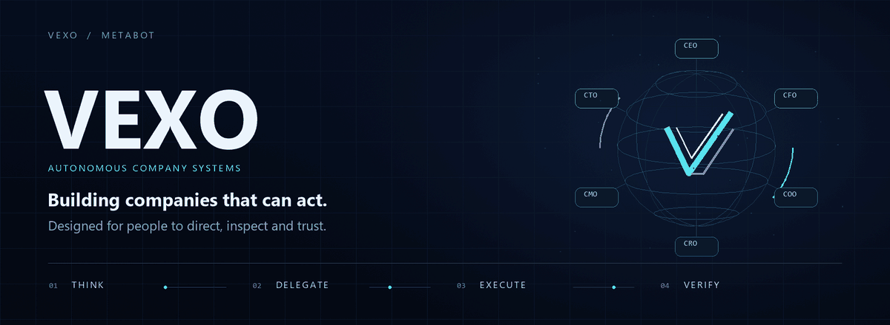

  <a href="https://github.com/metacallllc-lang/hermes-autonomous-company">
    <picture>
      <source media="(prefers-reduced-motion: reduce)" srcset="assets/vexo-company-poster.png">
      
    </picture>
  </a>

# VEXO · Building companies that can act

I’m building **MetaBot**, an operating system for AI-run companies that people
can direct, inspect and trust. The work connects an AI CEO and C-suite to durable
company state, governed tools and independently checked results.

Built on [Nous Research’s Hermes Agent](https://github.com/NousResearch/hermes-agent).
MetaBot is a division of **MetaCall LP**.

**[Explore the project](https://github.com/metacallllc-lang/hermes-autonomous-company)**
· **[See the architecture](https://github.com/metacallllc-lang/hermes-autonomous-company/blob/main/ARCHITECTURE.md)**
· **[For collaborators & investors](https://github.com/metacallllc-lang/hermes-autonomous-company/blob/main/INVESTORS.md)**

## The work

**Think → delegate → execute → verify.**

An agent response is only the beginning. The system must know who owns a task,
which actions are authorized, whether work actually finished and what the evidence
supports. That is the infrastructure I’m building in public.

| Explore | What you’ll find |
| --- | --- |
| [Autonomous company](https://github.com/metacallllc-lang/hermes-autonomous-company) | Architecture, operating records, experiments and proof boundaries. |
| [Hermes Agent fork](https://github.com/metacallllc-lang/hermes-agent) | Scoped build, Windows runtime, provider and test repairs, with upstream attribution. |
| [Current evidence](https://github.com/metacallllc-lang/hermes-autonomous-company/blob/main/PUBLIC_EVIDENCE_INDEX.md) | Dated results and the work still ahead. |

## Where it stands — November 20, 2026

The executives now look for income, not only act. The company opened four marketplace gigs it can deliver itself
(three live), built an order desk that takes an order from acknowledgement to a reviewed delivery under my veto,
and gave each seat a growth engine: brainstorm, run a measured experiment, research prospects, and launch an
offer only when it clears the margin rule and maps to a delivery the company can perform. The first
executive-launched offer and the first experiment followed, and thirteen faults that kept the loop from acting
were repaired.

No customer, collected revenue or funding is claimed yet.
[Read the November 20 evidence](https://github.com/metacallllc-lang/hermes-autonomous-company/blob/main/evidence/GROWTH_ENGINE_AND_ORDER_DESK_2026-11-20.md).

## Build with me

I’m interested in technical collaborators, research partners, exploratory pilots
and supporters who want to help make autonomous company execution inspectable.

**[Start a conversation](https://github.com/metacallllc-lang/hermes-autonomous-company/issues)**
· [Investor brief](https://github.com/metacallllc-lang/hermes-autonomous-company/blob/main/INVESTORS.md)
· [Preserved build history](HISTORY.md)
· [Still banner](assets/vexo-company-poster.png)

VEXO motion artwork: original procedural geometry and typography. Slow looping
motion with a static fallback; no live telemetry is implied by the graphic.
