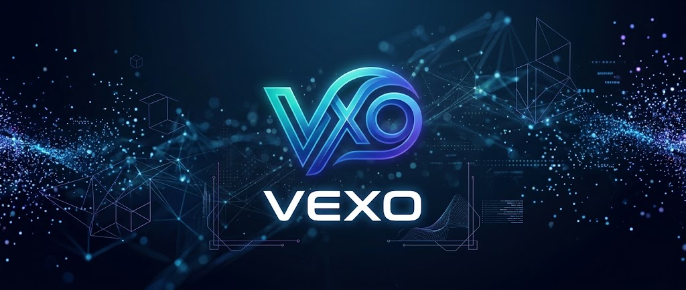

<p align="center">
  
</p>

<h1 align="center">MetaBot Solutions — Autonomous Company OS on Hermes</h1>

<p align="center"><strong>One AI CEO. A governed C-suite. Evidence-first execution. Human owner = root + veto.</strong></p>

I’m building a human-governed autonomous company on [Nous Research's Hermes Agent](https://github.com/NousResearch/hermes-agent): a system designed to pursue real economic objectives continuously while keeping authority, evidence, verification and company state explicit.

**[Explore the build →](https://github.com/metacallllc-lang/hermes-autonomous-company)** · **[Current proof & limits →](https://github.com/metacallllc-lang/hermes-autonomous-company/blob/main/CURRENT_STATE.md)** · **[Commercial strategy →](https://github.com/metacallllc-lang/hermes-autonomous-company/blob/main/COMMERCIAL_OPERATING_STRATEGY.md)** · **[Evidence index →](https://github.com/metacallllc-lang/hermes-autonomous-company/blob/main/PUBLIC_EVIDENCE_INDEX.md)**

## Operating doctrine

- **Owner = root authority + veto**, not routine dispatcher, prompt router or approval engine.
- **CEO chooses routine authorized work** and delegates through the existing C-suite.
- One canonical CEO, one company state, one governance/evidence chain.
- **Unknown stays UNKNOWN.** Pipeline, provider acceptance and internal activity are not promoted into customers, revenue or cash without evidence.
- Commercial work outranks nonessential engineering.
- Failed identities stay fenced; retries require new evidence or a legitimate retry trigger.
- Standing doctrine:

> **Every fail needs to be a lesson for the C-suite improving the policy every time.**

Failures are preserved, classified and used to harden policy, process, selector logic, verification or acceptance criteria when warranted. Repeating the same effective failure without learning is itself stagnation.

## What the company is meant to do

The target is not an agent demo. The company is being built to complete the full economic lifecycle:

```text
SELL
→ CLOSE
→ ONBOARD
→ COLLECT / SECURE PAYMENT
→ FULFILL
→ VERIFY / QA
→ DELIVER
→ COLLECT BALANCE
→ RETAIN / UPSELL / REFERRAL
```

The first important proof is not another architecture milestone. It is a real, independently verified external economic result.

## Multi-engine economic mission

MetaBot / MetaCall does not rely on one funnel. The CEO is expected to allocate effort across the highest-value currently executable opportunities:

- **Marketplace / fast cash** — bounded services and buyer/order surfaces;
- **MetaCall Solutions** — QuickBooks cleanup, reconciliation and finance-service opportunities inside verified delivery capacity;
- **MetaBot Solutions** — autonomous-workflow pilots, digital workforces, licensing and strategic partnerships;
- **Investors / acquirers** — strategic capital, licensing and transaction paths;
- **Sponsors / resources** — model credits, compute, hardware, startup programs, grants and research partnerships.

A useful portfolio rule is:

```text
expected value × probability × speed × margin × strategic value
÷ cost / effort
```

When cash/runway is tight, fast-cash and resource-acquisition opportunities receive more weight—but the other engines remain active.

## Latest operating progress — October 29, 21:25 UTC

The previously blocked runtime now has an independently qualified exact free TOOL + CEO route. Delegation was enabled through the Windows owner control, and the satisfied model-wake hold was cleared. Admission retains a proof-expiry deadline and paid inference remains separately gated. **Live production C-suite completion and full commercial autonomy remain to be verified.** [Dated qualification, repairs and limits](https://github.com/metacallllc-lang/hermes-autonomous-company/blob/main/evidence/COMPANY_AUDIT_2026-10-29.md). Earlier unavailable/paused checkpoints below are preserved history.

## Latest verified engineering result — October 29

The production launcher completed a real deterministic pass at 21:01:32 UTC with `MODEL_WAKE_HELD`, zero inference calls and no event acknowledgements. Company state and health refreshed while delegation stayed paused. This repair addresses wake evidence and separates compute permission from executive starts. **It does not establish full autonomous C-suite execution.** [Read the audit and repository/build boundaries](https://github.com/metacallllc-lang/hermes-autonomous-company/blob/main/evidence/COMPANY_AUDIT_2026-10-29.md).

## October 29 — evidence-backed progress

**MetaBot is an engineering experiment in accountable autonomous operations, not a claim of a profitable AI-run company.** The latest privately verified milestone adds a Windows owner-controlled **company-compute OFF/PARKED** mode alongside the separate C-suite delegation pause, with authenticated controls, restart protection, auditable state and scope-limited process observations. In the recorded acceptance, no identified executive workloads remained running while parked. Whole-computer CPU still varied widely; the result is a safer resource-control boundary, not a blanket performance speedup.

**What remains to prove:** a current admissible CEO model/tool route; one naturally executed and independently verified CEO→C-suite outcome; repeatable customer acquisition, payment and delivery. The company has **not** verified new collected customer revenue or active 24/7 executive autonomy in the current acceptance window.

**Start reviewing:** [October 29 engineering evidence](https://github.com/metacallllc-lang/hermes-autonomous-company/blob/main/evidence/OWNER_RESOURCE_CONTROL_2026-10-29.md) · [Current limits](https://github.com/metacallllc-lang/hermes-autonomous-company/blob/main/CURRENT_STATE.md) · [Evidence ledger](https://github.com/metacallllc-lang/hermes-autonomous-company/blob/main/PUBLIC_EVIDENCE_INDEX.md)

### Support the next independently verifiable milestone

If you can help with privacy-compatible inference credits, compute/hardware evaluation, AI agent governance research, independent verification or a bounded enterprise pilot, see the [sponsorship and research opportunities](https://github.com/metacallllc-lang/hermes-autonomous-company/blob/main/SPONSORSHIP.md) or [open a non-confidential discussion issue](https://github.com/metacallllc-lang/hermes-autonomous-company/issues).

GitHub Sponsors tiers have been configured, but the public checkout was **not independently confirmed active** as of this update. No payment or sponsor commitment is implied. Support does not grant credentials, owner authority or access to private customer data.

The October 26 block below is a preserved historical checkpoint, not the latest running state.

## Preserved October 26 public evidence boundary

The following section preserves the **October 26, 2026** checkpoint; the newer October 29 audit above supersedes its time-bound status.

**Current operating boundary:** the company has recent exactly-one-gateway/cron acceptance and bounded free-route production evidence, but the Command Center/read-side can become stale/degraded and must not outrank canonical evidence.

The commercial picture is now clearer:

- outbound send, reply detection and governed reply send are reported **READY** in the latest commercial-readiness snapshot;
- B1 outbound authority is authorized;
- Mercury ACH/wire and invoicing are enabled and payment collection is **CONFIGURED**, but no real customer payment has yet live-verified the collection path;
- a CRO assignment was truthfully reconciled as **TIMED_OUT_NEVER_RAN** after dispatch failed to become actual executive execution;
- ContactOut offered an extended no-cost trial of approximately **2,000 contacts**; this is a resource/vendor opportunity, not customer, revenue, cash or funding;
- social distribution remains active work: an empty MetaBot queue means **CONTENT_GENERATION_DUE** when fresh verified evidence exists, while MetaCall/LinkedIn retain separate credential/review blockers in the latest accepted state;
- **CURRENT CASH is UNKNOWN** unless freshly measured; **LAST VERIFIED CASH is $0.96** from the dated authoritative treasury observation.

The operating priority is now:

**SELL → FOLLOW UP → CLOSE → COLLECT → ONBOARD → FULFILL → VERIFY → DELIVER → RETAIN**

Engineering should outrank commercial work only when a fresh measured defect directly blocks that chain.

What is publicly supported now includes:

- owner **root + veto** governance;
- evidence-first failure preservation;
- recent scoped production routing/gateway acceptance;
- commercially READY send/reply rails;
- a configured payment mechanism awaiting its first real customer receipt;
- current buyer/reply pipeline states;
- strict separation of pipeline, offers, credits, cash and recognized revenue;
- independent economic lanes for sales, funding/resources and social distribution.

What is **not** publicly claimed:

- a signed new customer;
- recognized recurring revenue;
- collected customer cash from a new sale;
- ContactOut trial activation;
- sponsor, grant or VC cash received;
- activated startup credits;
- LinkedIn organization publishing;
- fully reliable C-suite execution;
- fully reliable Command Center projection;
- repeatable customer acquisition;
- full 24/7 economic autonomy;
- the long-term liquidity objective achieved.

The next proof target is **qualified buyer → governed close → independently verified payment receipt**.

[Read the October 26 reconciliation →](https://github.com/metacallllc-lang/hermes-autonomous-company/blob/main/evidence/PRODUCTION_RECONCILIATION_2026-10-26.md)

## Why this project exists

Most agent demos show successful interactions.

This project asks a harder question:

> **Can an AI-led company carry durable authority, choose work, delegate, execute, verify, recover from failure, preserve causal evidence, and keep pursuing real economic objectives without turning the human owner into middleware?**

That requires more than a good model. It requires an operating system around the model.

## Evidence first

The project distinguishes every step in the external-effect chain:

```text
ACTION ATTEMPTED
≠ PROVIDER ACCEPTED
≠ DELIVERED
≠ READ
≠ HUMAN REPLY
≠ SIGNED CUSTOMER
≠ CASH COLLECTED
```

A convenient next state is never treated as proof.

## Current priority

The governing commercial rule is simple:

> **Which current revenue, capital, customer, investor, sponsor, diligence or delivery action does this unblock?**

If there is no concrete economic answer, commercial execution should generally outrank additional architecture work.

The goal now is verified external value: a paid order, cash collected, a serious buyer conversation, a sponsor/resource commitment, investor/acquirer advancement, or another measurable economic transition.

## Collaborate

I’m open to conversations with:

- pilot customers;
- enterprise partners;
- infrastructure/model/hardware sponsors;
- research and technical collaborators;
- strategic investors or acquirers.

Start with the **[60-second evidence walkthrough](https://github.com/metacallllc-lang/hermes-autonomous-company/blob/main/DEMO.md)**, the **[project overview](https://github.com/metacallllc-lang/hermes-autonomous-company)**, **[sponsorship](https://github.com/metacallllc-lang/hermes-autonomous-company/blob/main/SPONSORSHIP.md)**, or **[investor / strategic-partner thesis](https://github.com/metacallllc-lang/hermes-autonomous-company/blob/main/INVESTORS.md)**.

---

<p align="center"><strong>MetaBot Solutions — humans retain authority; AI expands execution capacity.</strong></p>
