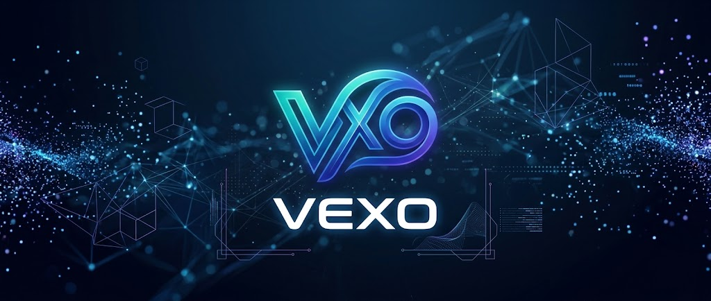

  

# MetaBot / MetaCall

I’m building governed autonomous company operations on
[Nous Research’s Hermes Agent](https://github.com/NousResearch/hermes-agent).
The work connects an AI CEO and C-suite with explicit authority, durable company
state, bounded execution and independent evidence checks.

| Project | What is here |
|---|---|
| [Hermes Agent fork](https://github.com/metacallllc-lang/hermes-agent) | Agent source and build compatibility work. [Current build repair](https://github.com/metacallllc-lang/hermes-agent/pull/3). |
| [Autonomous company operating record](https://github.com/metacallllc-lang/hermes-autonomous-company) | Public architecture, dated evidence, commercial strategy and operating limits. |

## Current evidence — November 2, 2026

The private company remains **commercially stalled**. A false dashboard alert
about a missing CEO completion was repaired; a fresh read-only observation on
November 2 still reported **STAGNATION**. A completed scheduled check is not
proof of useful executive work or an economic result.

The most recent complete company audit passed **137 of 149 suites**, with
**12 failures**, before a later six-file monitoring correction. Three focused
observer suites passed afterward. Full company build acceptance remains
incomplete; the complete audit has not been rerun after that follow-up.

Earlier healthy startup checks and free model selections remain dated evidence.
**No verified client, collected customer revenue, funding award or continuous
commercial autonomy is established by these checks.**

The private company integration is separate from the public Hermes fork. Public
documentation does not ship that integration or certify every historical guard.
The [fork build repair](https://github.com/metacallllc-lang/hermes-agent/pull/3)
passed all expected hosted workflows on reviewed head `fc1c81404f20` and was merged.
That acceptance includes 60,471 Linux tests, Windows x64 and ARM64, JavaScript,
macOS and selected package builds. It does not certify future commits or releases.

[Current operating evidence](https://github.com/metacallllc-lang/hermes-autonomous-company/blob/main/evidence/GITHUB_REVIEW_2026-11-02.md)
· [Evidence index](https://github.com/metacallllc-lang/hermes-autonomous-company/blob/main/PUBLIC_EVIDENCE_INDEX.md)
· [Commercial strategy](https://github.com/metacallllc-lang/hermes-autonomous-company/blob/main/COMMERCIAL_OPERATING_STRATEGY.md)
· [Preserved profile history](HISTORY.md)
