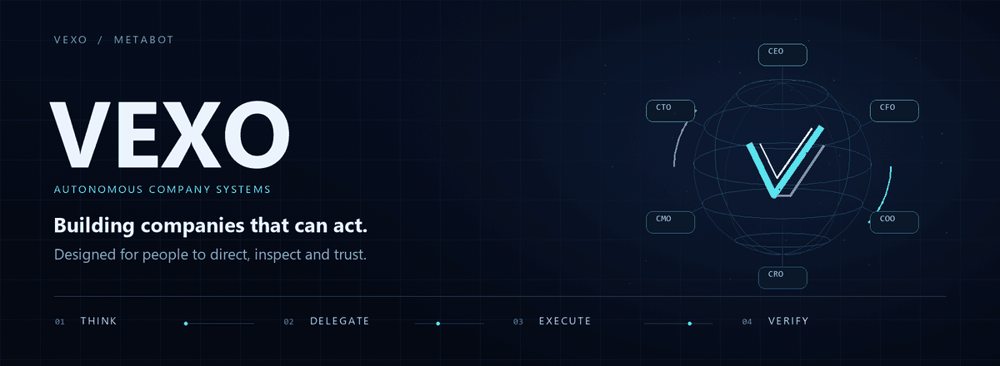

  <a href="https://github.com/metacallllc-lang/hermes-autonomous-company">
    <picture>
      <source media="(prefers-reduced-motion: reduce)" srcset="assets/vexo-company-poster.png">
      
    </picture>
  </a>

# VEXO · Building companies that can act

I’m building **MetaBot**, an operating system for AI-run companies that people
can direct, inspect and trust. The work connects an AI CEO and C-suite to durable
company state, governed tools and independently checked results.

Built on [Nous Research’s Hermes Agent](https://github.com/NousResearch/hermes-agent).
MetaBot is a division of **MetaCall LP**.

**[Explore the project](https://github.com/metacallllc-lang/hermes-autonomous-company)**
· **[See the architecture](https://github.com/metacallllc-lang/hermes-autonomous-company/blob/main/ARCHITECTURE.md)**
· **[For collaborators & investors](https://github.com/metacallllc-lang/hermes-autonomous-company/blob/main/INVESTORS.md)**

## The work

**Think → delegate → execute → verify.**

An agent response is only the beginning. The system must know who owns a task,
which actions are authorized, whether work actually finished and what the evidence
supports. That is the infrastructure I’m building in public.

| Explore | What you’ll find |
| --- | --- |
| [Autonomous company](https://github.com/metacallllc-lang/hermes-autonomous-company) | Architecture, operating records, experiments and proof boundaries. |
| [Hermes Agent fork](https://github.com/metacallllc-lang/hermes-agent) | Scoped build, Windows runtime, provider and test repairs, with upstream attribution. |
| [Current evidence](https://github.com/metacallllc-lang/hermes-autonomous-company/blob/main/PUBLIC_EVIDENCE_INDEX.md) | Dated results and the work still ahead. |

## What works now · November 6, 2026

A redesigned VEXO command center shows completed steps, blockers, executive
ownership and the next action. Normal CEO scheduling has independently reconciled
at least two CRO tasks, each running once on **DeepSeek V4.1 Flash 1017 via OpenRouter**.
Cycle, ownership and Hermes v0.23 duplicate-execution defects are repaired.
Recent hardening adds verified task handoffs and safe runtime maintenance;
all **27 focused repair checks pass**. The complete source audit was repeated
after those changes, with the result below unchanged.

The new complete audit ran **157 suites: 148 passed, 9 did not pass**.
Historical proof and integration coverage limits remain explicit. Internal task
completion is verified; customer conversion, collected revenue, funding awards
and self-funding remain unproven. [Read the repair evidence](https://github.com/metacallllc-lang/hermes-autonomous-company/blob/main/evidence/CYCLE_DASHBOARD_REPAIR_2026-11-06.md).

The original 48-hour field trial ends **November 8 at 10:36 AM Guatemala time**.
The [Hermes build PR](https://github.com/metacallllc-lang/hermes-agent/pull/4) is
reviewed separately from private company operation.

## Build with me

I’m interested in technical collaborators, research partners, exploratory pilots
and supporters who want to help make autonomous company execution inspectable.

**[Start a conversation](https://github.com/metacallllc-lang/hermes-autonomous-company/issues)**
· [Investor brief](https://github.com/metacallllc-lang/hermes-autonomous-company/blob/main/INVESTORS.md)
· [Preserved build history](HISTORY.md)
· [Still banner](assets/vexo-company-poster.png)

VEXO motion artwork: original procedural geometry and typography. Slow looping
motion with a static fallback; no live telemetry is implied by the graphic.
